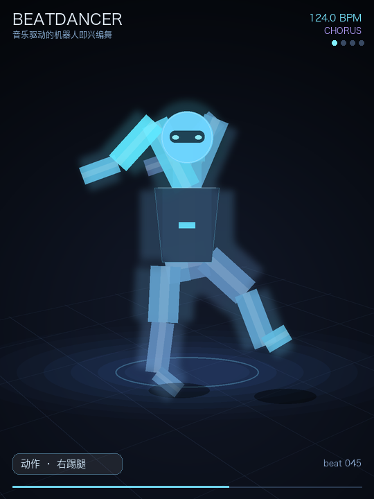

# BeatDancer · 给机器人一副耳朵，它自己会编舞

> 2026 地瓜机器人黑客松（DDC2026）参赛项目 · 48 小时 · 上海张江
> 输入一首歌，输出一套能落在 16 个舵机上的舞蹈；换成现场随便放的歌，它也能即兴跳。

**一句话**：把「听懂音乐」和「跳得出舞」之间的那道缝补上——节拍分析、结构化编舞、动作重定向、舵机执行，四个环节全部开源、全部能在 RDK X5 上跑。

<p align="center">
  
</p>

<p align="center">
  <a href="dist/demo.mp4">▶ 演示视频（带音轨）</a> ·
  <a href="dist/beatdancer.html">🕹 网页 Demo（双击即开）</a> ·
  <a href="docs/BeatDancer项目书_2026地瓜机器人黑客松.pdf">📄 项目书 PDF</a> ·
  <a href="docs/报名表填写.md">📝 报名表文案</a>
</p>

---

## 30 秒看懂

```bash
# 1. 本地跑通（只需要 numpy + pillow）
python -m beatdancer.cli demo assets/demo_track.wav --out dist

# 2. 双击打开这个文件，就能看到机器人跟着音乐跳舞
open dist/beatdancer.html

# 3. 想要视频
python -m beatdancer.cli render assets/demo_track.wav --out dist
```

输出：

| 文件 | 是什么 |
|---|---|
| `dist/beatdancer.html` | **单文件网页 Demo**（音频已内嵌，双击即开，可录屏发小红书） |
| `dist/demo.mp4` / `preview.gif` | 带音轨的演示视频 / 静音预览 |
| `dist/choreo.json` | 编舞结果：BPM、拍点、段落、每个动作的时间轴 |
| `dist/servo_table.csv` | 50 Hz × 16 关节的舵机目标值（0–1000 tick） |
| `dist/servo_config.json` | 舵机 ID / 中位 / 方向 / 行程标定表 |
| `dist/dance.bvh` | 动作捕捉格式，能直接拖进 Blender 出大片 |
| `dist/g1_qpos.csv` | 映射到 Unitree G1 关节名的轨迹 |

---

## 它到底解决了什么

| 现实问题 | 现在的做法 | BeatDancer 的做法 |
|---|---|---|
| 编舞靠人肉 | 一个 30 秒动作要调半天 | 动作基元 + 动态规划，**0.2 秒**生成整首 |
| 音乐换了就废 | 动作和音乐写死 | 节拍跟踪 + 段落识别，换歌自动重编 |
| 动作像机械臂 | 关键帧直线插值 | 相位驱动 + 叠加律动，动作自带"弹性" |
| 舵机被跳坏 | 直接下发角度 | 速度限幅 + 足底落地约束 + 温度看门狗 |
| 电脑上好看，板子上跑不动 | 依赖 librosa/torch | **纯 numpy**，端侧分析 100× 实时 |

## 技术原理（四层）

```
                ┌─────────────────────────────────────────────┐
  一首歌 ──────▶ │ ① 听觉层  onset → 速度 → 拍点 → 小节 → 段落 │
                └──────────────────────┬──────────────────────┘
                                       ▼
                ┌─────────────────────────────────────────────┐
                │ ② 大脑层  乐句 → 动作基元序列（动态规划）    │
                │   代价 = 能量匹配 + 衔接距离 + 重复惩罚      │
                └──────────────────────┬──────────────────────┘
                                       ▼
                ┌─────────────────────────────────────────────┐
                │ ③ 身体层  50 Hz 采样 → 关节限位 → 足底贴地   │
                └──────────────────────┬──────────────────────┘
                                       ▼
      RDK X5 ──── ④ 执行层  Feetech 总线 SYNC_WRITE，16 舵机同帧
```

**① 听觉层**（`beatdancer/audio.py`）
对数梅尔谱 → 半波整流谱通量 → 局部去趋势得到 onset 包络；自相关估速度（带对数先验，避免半速/倍速错判）；Ellis 动态规划追踪拍点；再用「脉冲串对齐」把拍点网格吸到真实瞬态上（这一步把 BPM 误差从 0.8% 压到 0.02%）；最后按小节聚合纹理特征做变点检测，切出 intro / verse / chorus / outro。

**② 大脑层**（`beatdancer/motion.py` + `choreo.py`）
21 个动作基元（点步、摆胯、迪斯科指天、踢腿、转体、跳跃……），每个带「几拍 / 能量 / 是否腾空 / 支撑脚」标签。编舞是一个带记忆的 DP：在每个 8 拍乐句上找一条代价最小的动作链，代价 = 能量不匹配 + 相邻动作衔接距离 + 连续重复惩罚；段落第一句成为"动机"，后面按「镜像 / 换同类动作」做呼应，副歌因此会有"记忆点"而不是随机堆动作。

**③ 身体层**（`beatdancer/skeleton.py`）
16 自由度人形（腰、头、双臂各 3、双腿各 4），正向运动学 + 关节限位。采样到 50 Hz 后做三件事：段落接缝交叉淡化、角速度限幅（0.22 rad/帧）、**足底贴地**（腿弯了就抬胯，而不是让脚插进地板）。

**④ 执行层**（`rdk/`）
Feetech STS 总线，一条 `SYNC_WRITE` 广播包同时更新 16 个舵机；`--mode live` 时用 10 ms 帧的实时节拍跟踪驱动即兴选动作，断拍 2 秒自动回到安全姿态。

## 实测（MacBook / 一首 124 BPM、35.3 秒的原创电子乐）

| 指标 | 数值 |
|---|---|
| BPM 估计 | 123.98（真值 124.00，误差 **0.02%**） |
| 拍点网格 | 73 拍，小节线对齐第一个强拍 |
| 段落切分 | intro 0–7 / verse 7–23 / chorus 23–55 / outro 55–71 |
| 编舞耗时 | 0.20 s（35 秒音乐，生成 21 个动作段） |
| 分析耗时 | 0.36 s（约 100× 实时，纯 numpy） |
| 轨迹 | 1767 帧 @ 50 Hz × 16 关节 |
| 渲染 | 884 帧 / 约 60 s（纯 Pillow 软渲染，无 GPU） |

> 复核命令：`python -m unittest discover tests -v`

## 板端部署（RDK X5）

```bash
# 板子上（已装 hobot 系统 + pyserial）
pip install pyserial
python -m rdk.dance_service --mode replay --table dist/servo_table.csv --port /dev/ttyUSB0
python -m rdk.dance_service --mode live            # 现场随便放首歌
```

延迟预算、接线、BOM 见 [rdk/README.md](rdk/README.md)。

## 目录

```
beatdancer/
├── beatdancer/          核心库：audio / motion / skeleton / choreo / render / export
├── web/index.html       网页播放器（单文件构建后可直接发人）
├── rdk/                 板端：实时节拍、舵机总线、50 Hz 运行时
├── sim/                 Unitree G1 仿真回放
├── tools/               原创 demo 曲生成器（无版权风险）
├── tests/               单元测试（BPM 精度 / 覆盖性 / 限位）
└── docs/                项目书、报名表文案、48h 作战计划
```

## 站在哪些开源项目的肩膀上

我们**没有直接 fork**（避免许可证污染进参赛仓库），而是把思路、协议和命名搬进自己的实现，并在代码注释里标了出处：

| 项目 | 许可证 | 我们用了什么 |
|---|---|---|
| [CPJKU/beat_this](https://github.com/CPJKU/beat_this) | MIT | 谱通量 + DP 追拍 + 脉冲对齐的工程思路 |
| [librosa/librosa](https://github.com/librosa/librosa) | ISC | 梅尔滤波器组与 onset 包络的参考实现（我们重写为无依赖版） |
| [huggingface/lerobot](https://github.com/huggingface/lerobot) | Apache-2.0 | Feetech 总线 `SYNC_WRITE` 打包方式 |
| [google-deepmind/mujoco_menagerie](https://github.com/google-deepmind/mujoco_menagerie) | 各模型自带 | Unitree G1 关节命名，用于重定向导出 |
| [D-Robotics/rdk_model_zoo](https://github.com/D-Robotics/rdk_model_zoo) | Apache-2.0 | BPU 量化/部署流程参考（`rdk/hb_mapper_*.json`） |

详见 [THIRD_PARTY.md](THIRD_PARTY.md)。

## 路线图

- [x] 节拍/段落分析、DP 编舞、50 Hz 轨迹、软渲染、单文件网页
- [x] Feetech 总线驱动、回调放、即兴模式（dry-run 可跑）
- [ ] 摄像头姿态跟随（RDK X5 + YOLO-Pose，BPU 上 30 FPS）
- [ ] 观众节拍互动（拍手 → 机器人接拍）
- [ ] 双机编舞（两人形同步/对舞）

## 文档

| 文件 | 给谁看 |
|---|---|
| [docs/项目书.md](docs/项目书.md) / [PDF](docs/BeatDancer项目书_2026地瓜机器人黑客松.pdf) | 想完整理解原理、48h 计划、路演脚本的人 |
| [docs/报名表填写.md](docs/报名表填写.md) | 要填报名表的人（逐字段给好可复制文案） |
| [docs/发布指南.md](docs/发布指南.md) | 要把这个仓库推到自己 GitHub 的人 |
| [rdk/README.md](rdk/README.md) | 要在板子上接线、跑真机的人 |
| [THIRD_PARTY.md](THIRD_PARTY.md) | 关心许可证和出处的评委/维护者 |

## License

代码 MIT。`assets/demo_track.wav` 由 `tools/make_demo_track.py` 纯合成，无第三方音频。
