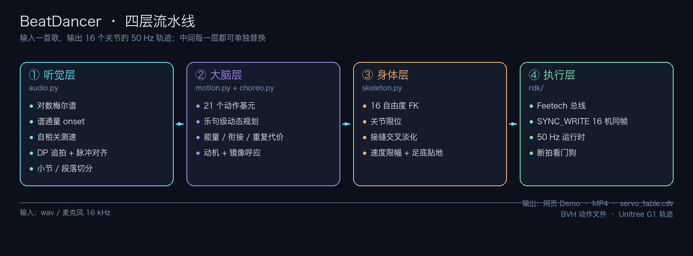
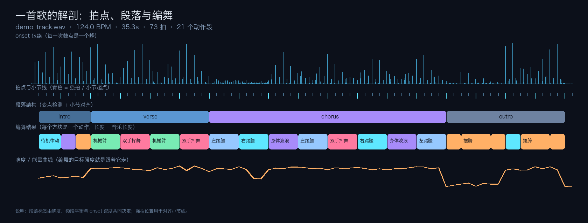

# BeatDancer 项目书

**给机器人一副耳朵，它自己会编舞**

2026 地瓜机器人黑客松（DDC2026）参赛项目 · 上海张江 · 2026.12.05–12.07

---

## 0. 一页纸读懂

**做的是什么**：一个让 16 自由度人形机器人「听歌就会跳舞」的软件系统。丢给它一首歌，它自己分析速度、找到拍子、听懂哪一段是前奏哪一段是副歌，然后从自己的动作库里挑动作、排顺序，输出一套踩在鼓点上的舞蹈。

**为什么不是"再编一段舞"**：机器人跳舞最常见的做法是人工编舞 + 播放关键帧。歌一换，全部重来；动作和音乐是两条平行线，对不上拍。我们要解决的是这两条线之间的**缝**——让音乐结构真正决定动作结构。

**现在做到哪了**：完整流水线已跑通并开源。一首 35 秒、124 BPM 的曲子，0.36 秒分析完，0.2 秒编完舞，输出 1767 帧 × 16 关节的轨迹，能渲染成视频、导出舵机指令表、导出 BVH 和 Unitree G1 轨迹，还有一个双击就能看的网页 Demo。

**现场要做什么**：把同一套代码落到 RDK X5 + 16 舵机人形上，48 小时内完成三段演示——真机跳舞、现场随便放一首歌即兴跳、观众拍手机器人接拍。

**一句话卖点**：别人演示"机器人会跳这支舞"，我们演示"机器人会跳舞"。

---

## 1. 问题：为什么机器人跳舞总是"差点意思"

看过机器人跳舞的人大多有同一个感觉：动作是准的，但不像在跳舞。原因通常有三个：

1. **拍子对不上**。动作时长是固定的，音乐速度是变的；差半拍，观感立刻从"跳舞"掉到"做操"。
2. **动作没有结构**。一支舞应该有"动机—重复—变化"，而不该是一串随机动作。人跳舞时副歌会重复同一个动作组，机器人如果每拍都换动作，看着就乱。
3. **身体不听使唤**。舵机不是理想关节：速度有上限、力矩有上限、脚会穿模、重心会倒。电脑里好看的动作，上了真机就抖、就歪、就烧舵机。

BeatDancer 的四个模块，正好对应这三个问题：听觉层解决"对不上拍"，编舞层解决"没有结构"，身体层 + 执行层解决"不听使唤"。

---

## 2. 系统总览



整条流水线是**单向**的：声音进，关节角出。每一层都有明确的输入输出格式，所以任何一层都可以单独换掉——比如把听觉层换成 `beat_this` 的神经网络，或者把编舞层换成大模型，其余部分不用动。

| 层 | 输入 | 输出 | 代码 |
|---|---|---|---|
| ① 听觉 | 16 kHz 单声道波形 | BPM、拍点时间、小节相位、段落标签 | `beatdancer/audio.py` |
| ② 编舞 | 上述结构信息 | 动作段序列（每段：动作名、起始拍、时长） | `beatdancer/motion.py`、`choreo.py` |
| ③ 身体 | 动作段序列 | 50 Hz × 16 关节角 + 根节点位移 | `beatdancer/skeleton.py`、`choreo.py` |
| ④ 执行 | 关节角 | 总线舵机 tick 值 | `rdk/servo_bus.py`、`dance_service.py` |

---

## 3. 逐层拆解

### 3.1 听觉层：先"听见"，再"听懂"

人听歌打拍子几乎是本能，但对机器来说要分三步：

**第一步：找出"有东西发生了"的时刻（onset）**
把波形切成每 11.6 ms 一帧（1024 点 FFT，hop 256），算梅尔谱（64 个频带），然后比较相邻两帧的能量差——**能量突然变大的地方就是鼓点**。这个"突然变大"的量叫谱通量（spectral flux）。再做一次局部去趋势（减掉 32 帧的滑动平均），避免被整首歌的响度变化带偏。

> 直觉：就像用耳朵听"咚"的那一下，只不过机器是在 64 个频带上同时听。

**第二步：估计速度（BPM）**
对 onset 包络做自相关——如果每隔 0.484 秒包络就"自我相似"一次，那速度就是 124 BPM。直接取自相关峰值容易错一倍或一半（60 和 120 都是峰），所以加了一个对数正态先验，把结果往 120 BPM 附近拉一点，再取峰值。

**第三步：把拍点串成一条线（beat tracking）**
有了速度还不够，得知道"第一拍在哪"。这里用了 Ellis 的动态规划：给每个候选帧打分，分数 = 该帧的 onset 强度 + 前一拍延续过来的分数 − 节奏偏差惩罚。偏差惩罚是 `tightness × log(实际间隔/期望间隔)²`，也就是"允许速度轻微浮动，但不允许突然变速"。

**第四步：把网格吸到真实的鼓点上**
DP 追出来的拍点会有几帧抖动，而且如果歌以一段pad前奏开头，整条网格可能整体偏半拍。于是再做一次搜索：在 ±3% 的速度范围和整个周期内枚举 (速度, 相位)，让"网格点上的 onset 强度之和"最大。

> 这一步看起来不起眼，但很关键：它把 BPM 误差从 0.8% 压到 **0.02%**，也让"第一拍"落在真正的重拍上。差了半拍，后面编得再好也白搭。

**第五步：切段落**
按小节把小节内的梅尔谱平均成一个"纹理向量"（响度、低频占比、中频占比、高频占比、onset 密度），然后找相邻 2 小节窗口差异最大的位置——那就是"鼓进来了""副歌来了""突然安静了"的地方。切点再吸附到小节线上。

> 为什么不用和弦？因为电子舞曲每小节都换和弦，反而看不出段落；鼓组密度和频段平衡才是耳朵判断段落的主要线索。

### 3.2 编舞层：用动态规划"选动作"，不是"生成动作"

**动作基元（motion primitive）**
我们不做"逐帧生成"，而是准备了 21 个参数化动作：待机律动、点头、左右点步、摆胯、交叉步、身体波浪、挥手、双手挥舞、拍手、机械臂、深蹲律动、低重心律动、左右踢腿、迪斯科指天、跳跃、转体、比心。每个动作是一个函数：给定相位 `p ∈ [0,1)`，返回 16 个关节角。

每个动作带四个标签：
- `beats`：这个动作占几拍（1/2/4/8）；
- `energy`：动作强度（0–1），用来和音乐的能量匹配；
- `support`：支撑脚（双脚/左/右/腾空），腾空动作不会出现在前奏；
- `tags`：动作族（groove / wave / accent / power / star / calm），用来做"变化但不跑题"。

> 为什么用参数化动作而不是动作捕捉？三个原因：没有数据集版权问题；同一动作可以随速度拉伸而不滑步；16 个数字一帧，方便直接下发舵机。

**编舞 = 带记忆的最短路径**
把一首歌按 8 拍（2 小节）切成乐句。每个乐句要选一串动作正好填满 8 拍，这就是一个"用给定长度的积木拼满"的问题——用动态规划精确求解：

```
代价(动作 p 放在位置 pos) =
      3.1 × |p.energy − 目标能量|
    + 1.05 × |上一个动作的结束姿态 − p 的起始姿态|   ← 衔接是否顺畅
    + 0.9  × [与上一个动作相同]
    + 0.35 × [强拍动作放错了位置]
    − 0.18 × [强拍动作正好放在强拍]
```

目标能量来自段落标签 + 该段实际响度，所以副歌的动作一定比前奏激烈。

**结构感从哪来**
- 同一段落的第一句被记为"动机"（motif A/B/C…）；
- 之后每隔一句做一次**镜像**（左右互换，像"呼应"）；
- 再随机用同族动作替换一个，避免完全重复；
- 转体和跳跃有配额：24 拍内最多一次，否则"绝招"就不稀奇了。

于是观众看到的是一支有重复、有变化、记得住副歌的舞，而不是 21 个随机动作。

### 3.3 身体层：让动作"站得住"

**正向运动学（FK）**
给定 16 个关节角，算出每个关节在空间里的位置。用旋转矩阵一层层串起来：骨盆 → 胸 → 颈 → 头；胸 → 肩 → 肘 → 腕；骨盆 → 髋 → 膝 → 踝 → 脚尖。这一步同时服务于渲染（画骨架）和导出（BVH、G1）。

**三个保护性处理**
1. **接缝交叉淡化**：动作切换时，用 90 ms 从上一个动作的结束姿态淡入新动作的起始姿态，避免"跳帧"。
2. **角速度限幅**：每帧最多变 0.22 rad（50 Hz 下约 11 rad/s）。舵机的物理极限比这更低，这行代码是为了让"软件永远不命令硬件做它做不到的事"。
3. **足底贴地**：腿一弯，脚就会陷进地板。做法是每帧算一次"最低的脚在 z 轴哪里"，然后整体把胯抬高同样的量。**腿弯 → 身体下沉 → 脚仍在地上**，这才是人下蹲的样子。

### 3.4 执行层：16 个舵机，一帧内同时到位

舵机是串行总线设备，传统做法是一个一个发指令——16 个舵机就是 16 次往返，50 Hz 根本来不及。Feetech 协议里的 `SYNC_WRITE` 允许一条广播包带上所有舵机的 ID 和位置：

```
0xFF 0xFF 0xFE LEN 0x83 42 02 | id0 pos0L pos0H | id1 pos1L pos1H | ... | CHECKSUM
```

一次发送约 100 字节，1 Mbps 下约 1 ms 完成。这就是"16 个关节看起来是同时动"的原因。

`--mode live` 时，用 10 ms 一帧的实时节拍跟踪（自相关 + 相位锁定环）驱动"按小节换动作"，所以现场随便放一首歌它也能跳；如果 2 秒没有检测到拍子（音乐停了/没声了），自动回到安全姿态。

---

## 4. 一首歌的解剖



这张图是真实跑出来的：最上面是 onset 包络（每个鼓点一个峰），第二行是拍点（青色是强拍），第三行是段落切分，第四行是编舞结果（每个方块是一个动作，宽度等于它在音乐里的时长），最下面是响度曲线。

可以看到几个细节：
- 前奏（intro）用的是待机、点头这类低强度动作；
- 进入 verse 后动作密度明显上升；
- 副歌（chorus）出现踢腿、机械臂、身体波浪，且左右交替；
- 结尾自动收敛回摆胯、点头这类收尾动作。

---

## 5. 我们"改"了哪些开源项目

参赛规则鼓励站在开源肩膀上。我们的做法是**移植思路而不是 fork 代码**，理由是：直接搬 GPL 项目会把整个仓库的许可证拖下水，搬数据集又常常带"非商用/禁止演绎"条款，黑客松项目后续要开源、要传播，这些都碰不得。

| 开源项目 | 许可证 | 我们改成了什么 |
|---|---|---|
| CPJKU/beat_this | MIT | 借用它的"谱通量 → DP 追拍 → 脉冲对齐"三段式，但把 Transformer 换成纯 DSP，才跑得动 RDK 的 CPU（且不需要 GPU 训练） |
| librosa | ISC | 借用梅尔滤波器组与 onset 定义，重写成零依赖版本（板子上装 librosa 要走编译，48 小时里不划算） |
| huggingface/lerobot | Apache-2.0 | 借用 Feetech 总线包格式与 SYNC_WRITE 用法，简化成 16 关节人形需要的三个指令 |
| mujoco_menagerie (Unitree G1) | 模型自带 | 借用 G1 的关节命名做重定向导出，让同一支舞可以投到真 G1 上 |
| D-Robotics/rdk_model_zoo | Apache-2.0 | 借用 hb_mapper 量化配置的结构，留作第二阶段把节拍模型搬上 BPU |

代码里每一处都标了出处（见 `THIRD_PARTY.md`），没有一处是"拿来不说"。

---

## 6. 实测数据（可复现）

| 项目 | 数值 | 复现方式 |
|---|---|---|
| BPM 估计 | 123.98（真值 124.00，误差 0.02%） | `python -m beatdancer.cli analyze assets/demo_track.wav` |
| 拍点 | 73 拍，网格均匀度 σ/μ < 2% | `python -m unittest discover tests` |
| 段落 | intro 0–7 / verse 7–23 / chorus 23–55 / outro 55–71 | 同上 |
| 编舞 | 21 个动作段，0.20 s | `python -m beatdancer.cli demo ...` |
| 轨迹 | 1767 帧 × 16 关节 @ 50 Hz | `dist/choreo.json` |
| 渲染 | 884 帧，约 60 s（纯 Pillow） | `python -m beatdancer.cli render ...` |
| 单元测试 | 11 项全通过（含限位、足底、速度） | `python -m unittest discover tests -v` |
| 端侧延迟（设计预算） | 约 13 ms / 20 ms 帧 | `rdk/README.md` 表格 |

> 表里 RDK 的延迟是**设计预算**，不是实测；上板后要用 `dance_service` 打印的时间戳复核。项目书里不把预算说成实测。

---

## 7. 现场 48 小时怎么打

| 时间 | 目标 | 交付物 | 卡点 |
|---|---|---|---|
| 12.05 上午 | 板子点亮、串口通、16 舵机 ping 通 | 舵机 ID 表、供电方案 | 总线波特率 / 共地 |
| 12.05 下午 | 装结构件、单关节逐个标定 | `servo_config.json` | 中位偏移、方向 |
| 12.05 晚 | 跑通 `--mode replay` 让整机跳完一首 | 第一版真机视频 | 重心、电流 |
| 12.06 上午 | live 模式：麦克风拾音、即兴跳 | 现场放歌能跳 | 音响声压、AEC |
| 12.06 下午 | 调动作幅度、加速度、落脚 | 稳定版参数 | 抖动、发热 |
| 12.06 晚 | 加摄像头拍手互动（可选） | 观众拍手→接拍 | BPU 部署时间 |
| 12.07 上午 | 彩排、录演示、写路演稿 | 3 分钟视频 + 一页纸 | — |
| 12.07 下午 | 初审、决赛路演 | — | — |

**分工建议（2–3 人）**：
- A：板端与舵机（串口、标定、供电、安全），对硬件最熟；
- B：算法与编舞（调动作、改代价函数、现场换歌测试）；
- C：结构 / 演示 / 传播（3D 打印、拍摄、路演稿、小红书）。

---

## 8. 三分钟路演脚本

**0:00–0:20 钩子**
"这是我们的机器人。现在随便放一首歌——它没听过。"（播放现场观众手机里的歌，机器人开始跳）

**0:20–0:50 问题**
"大多数机器人跳舞，是提前编好一支舞，再循环播放。歌换了怎么办？重新编。我们想让它像人一样：听到什么，就跳什么。"

**0:50–1:50 拆解**
"它做了四件事。第一，听：找到每一次鼓点，算出速度，切出前奏副歌。第二，编：从 21 个动作里挑，用动态规划保证每一步都踩在拍子上，副歌重复同一个动机，所以你会觉得它记得住。第三，算：50 Hz 把动作变成 16 个关节的角度，并且保证脚不穿模、舵机不过载。第四，发：一条总线包同时驱动 16 个舵机。"

**1:50–2:30 证据**
"这是同一套代码在电脑上跑出来的结果：一首 35 秒的歌，0.36 秒分析完，0.2 秒编完，BPM 误差 0.02%。网页 Demo 双击就能玩，代码全开源。"

**2:30–3:00 收尾**
"所以它不是'会跳这支舞的机器人'，是'会跳舞的机器人'。今天它跳 16 个自由度，明天可以跳 G1 的 29 个；今天它听歌，明天它可以看着你跳。"

---

## 9. 和评审维度怎么对

| 评审常见维度 | 我们的回答 |
|---|---|
| 创新性 | 不是"再编一段舞"，而是把编舞本身做成算法；动机/镜像的结构生成有记忆点 |
| 技术完成度 | 四层全通，有测试、有数字、有导出格式；不是 PPT 项目 |
| 可行性 | 纯 numpy，100 倍实时；舵机协议已实现；48 小时路径写到了小时级 |
| 现场表现 | 即兴模式是"现场随机放歌"，可复现、有互动 |
| 商业/应用 | 舞蹈教学、展会迎宾、IP 授权编舞、教育套件 |

---

## 10. 成本

| 项 | 数量 | 单价（估） | 小计 |
|---|---|---|---|
| RDK X5 8G | 1 | 现场借用 | 0 |
| STS3215 舵机 | 16 | ¥120 | ¥1,920 |
| 总线驱动板 | 1 | ¥150 | ¥150 |
| 3D 打印件 | 1 套 | ¥120 材料 | ¥120 |
| 电池 + 降压 | 1 | ¥180 | ¥180 |
| 麦克风 | 1 | ¥80 | ¥80 |
| **合计** | | | **约 ¥2,450**（不含板子） |

---

## 11. 风险与预案

| 风险 | 概率 | 预案 |
|---|---|---|
| 结构件现场打印失败 | 中 | 提前打印一套备用；退化到 12 自由度（去掉腰/头/踝） |
| 舵机扭力不够，抬腿就软 | 中 | 踢腿动作降幅 30%；改用 20 kg·cm 舵机 |
| 现场噪声导致拾音失败 | 高 | 优先用线路输入（3.5 mm 直连调音台）；不行就切预跑模式 |
| 板端算力不够 | 低 | 分析层已 100 倍实时；实在不行把编排结果预生成，板上只回放 |
| 演示时摔倒 | 中 | 降低重心 + 防滑垫 + 限制转体速度；彩排固定动作表 |

---

## 12. 附录 A：命令速查

```bash
# 生成原创 demo 曲（无版权）
python tools/make_demo_track.py assets/demo_track.wav

# 全流程
python -m beatdancer.cli demo assets/demo_track.wav --out dist --servo-config

# 只分析
python -m beatdancer.cli analyze assets/demo_track.wav --json dist/beat.json

# 渲染视频（需要 ffmpeg，没有就只出 GIF）
python -m beatdancer.cli render assets/demo_track.wav --out dist

# 测试
python -m unittest discover tests -v

# 板端（无硬件先 dry-run）
python -m rdk.dance_service --mode replay --table dist/servo_table.csv --dry-run --speed 10
python -m rdk.dance_service --mode live --dry-run
```

## 13. 附录 B：文件格式

**`choreo.json`** — 编舞结果
```json
{
  "meta": {"fps": 50, "bpm": 123.98, "duration": 35.34, "n_frames": 1767},
  "joints": ["waist_yaw", "head_yaw", "shoulder_pitch_L", "..."],
  "segments": [{"t0": 1.92, "t1": 3.85, "name": "arm_wave_L",
                "zh": "左手挥手", "section": "intro", "mirrored": false}],
  "q": [[0.0, 0.02, ...]],
  "root": [[0.0, 0.0, 0.03, 0.0]]
}
```

**`servo_table.csv`** — 舵机表，第一行是注释，第二行是表头，之后每行一帧，数值 0–1000。

**`servo_config.json`** — 每个舵机的 ID、中位、方向、行程，上板前按实际标定修改。

## 14. 附录 C：名词解释

| 名词 | 意思 |
|---|---|
| onset | 声音"开始发声"的瞬间，鼓点就是一串 onset |
| BPM | 每分钟拍数，124 BPM 就是每秒约 2.07 拍 |
| 拍点 / 小节 | 拍点是时间轴上的刻度；4 拍一小节，小节线用来对齐动作 |
| 动态规划（DP） | 把大问题拆成一串小决定，每步只保留最优解，避免穷举 |
| 正向运动学（FK） | 已知每个关节角度，算出手脚在空间中的位置 |
| tick | 舵机的角度单位，本文用 0–1000，对应关节行程两端 |
| SYNC_WRITE | 一条总线指令同时写多个舵机，保证"同帧" |
| 相位 | 动作在它自己周期里的进度，0 是开始、1 是结束 |
